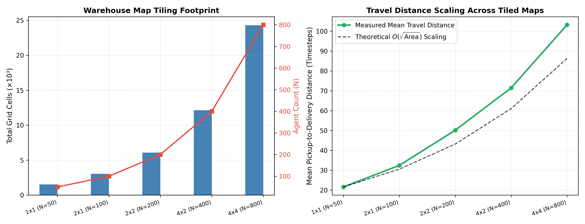
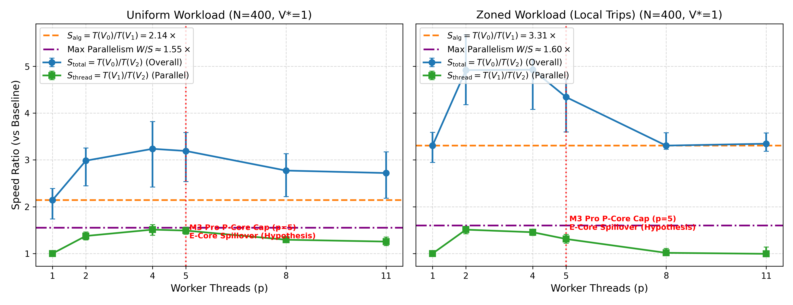
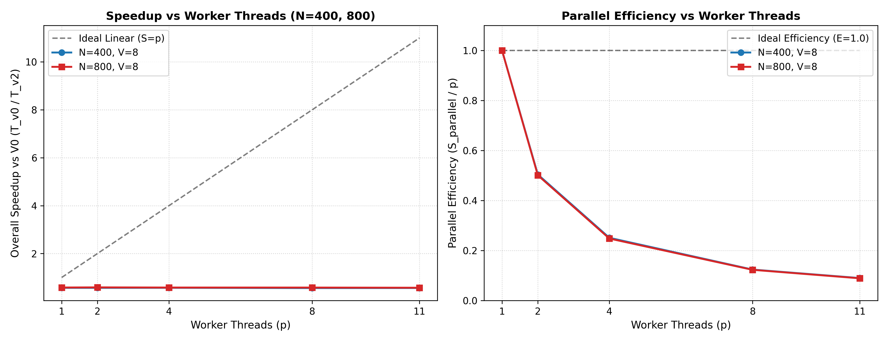
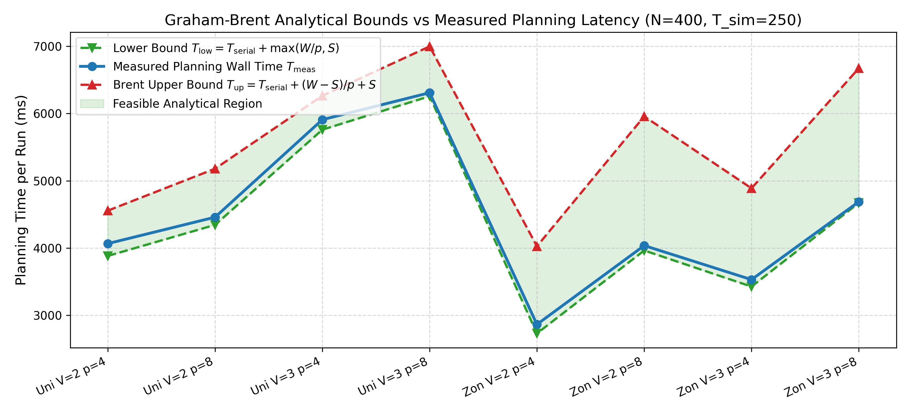
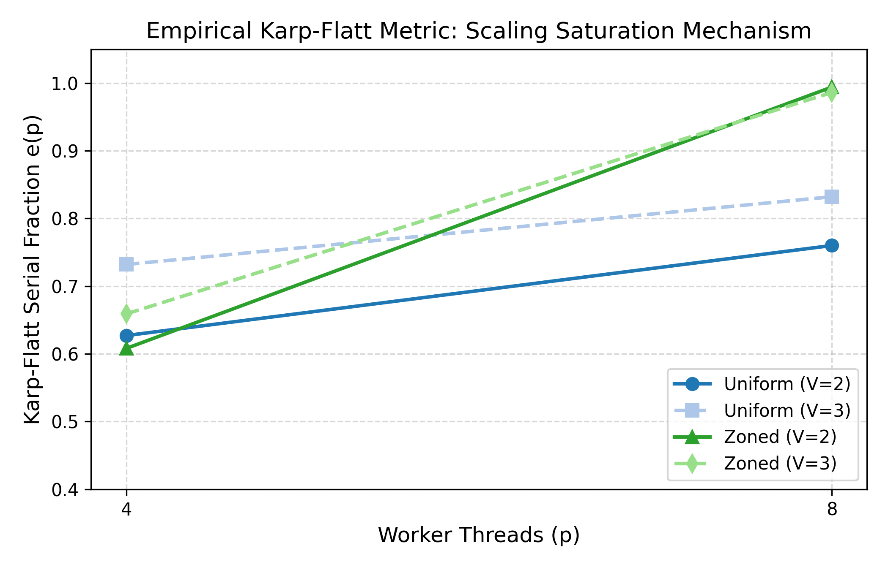
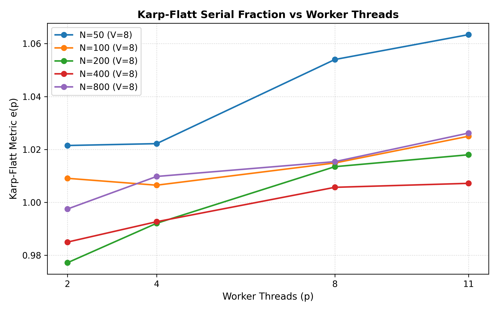
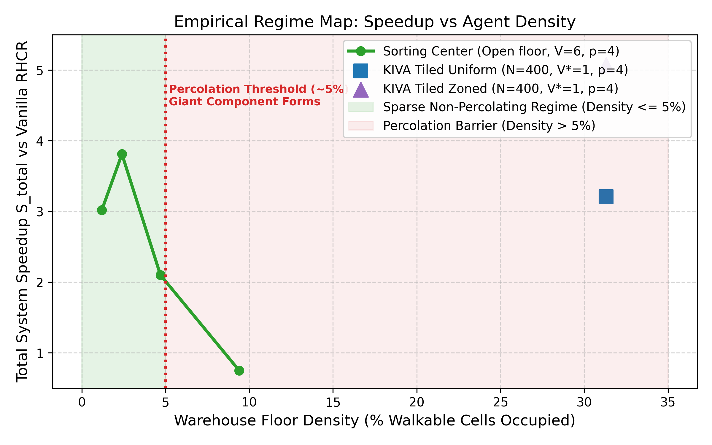
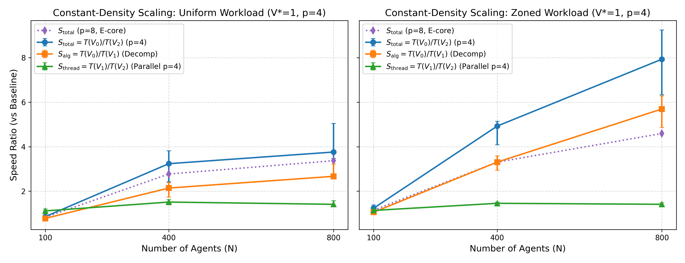
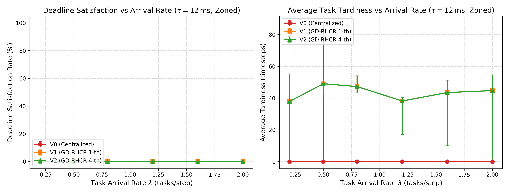
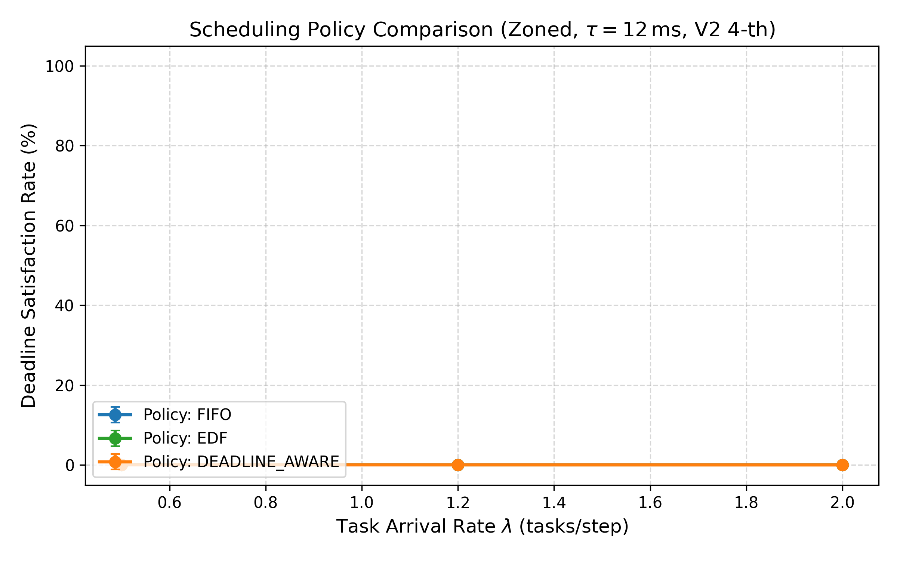

# Parallel GD-RHCR: Lifelong Multi-Agent Path Finding

[](https://isocpp.org/)
[](license.md)
[](https://cmake.org/)
[](#parallel-execution--replanning-pipeline)
[](#9-collision-freedom--correctness-gates-suite-c1c6)
[](#local-setup--installation)

> **IT301 Parallel Computing Course Project**  
> **Department of Information Technology, National Institute of Technology Karnataka (NITK), Surathkal**  
> **Course Guide:** Dr. Biju R Mohan  
> **Team Members:**  
> - **Chandan Gowda C** (241IT016) — Infrastructure, Parallel Primitives & Baseline Driver  
> - **D M Vikas** (241IT018) — Dynamic Poisson Workload, Deadlines & Real-Time Scheduling  
> - **Karan H** (241IT037) — GD-RHCR Parallel Core, DSU Local Conflict Resolution & Merging  
> - **Shashank Gupta** (241IT073) — Benchmarking Pipeline, Metrics Telemetry & Statistical Analysis  
>
> 📄 **Official Evaluation Report:** [docs/EVALUATION_REPORT.md](docs/EVALUATION_REPORT.md)  
> 📊 **Experimental Scorecard:** [docs/SCORECARD.md](docs/SCORECARD.md)  
> 📑 **Presentation Outline:** [docs/PRESENTATION_OUTLINE.md](docs/PRESENTATION_OUTLINE.md)  
> 📜 **Architecture Decisions Log:** [docs/DECISIONS.md](docs/DECISIONS.md)

---

## Table of Contents

1. [Overview & Parallel Architecture](#overview--parallel-architecture)
2. [Key Features & Capabilities](#key-features--capabilities)
3. [Visual Feature Walkthrough & Empirical Results](#visual-feature-walkthrough--empirical-results)
   - [Warehouse Layouts & Spatial Partitioning](#1-warehouse-layouts--spatial-partitioning)
   - [Strong Scaling & Hardware Speedup ($p \in [1, 11]$)](#2-strong-scaling--hardware-speedup-p-in-1-11)
   - [Graham-Brent Analytical Bounds & Work/Span Waterfall](#3-graham-brent-analytical-bounds--workspan-waterfall)
   - [Karp-Flatt Metric & Asymmetric Core Contention](#4-karp-flatt-metric--asymmetric-core-contention)
   - [Density Regime Map & Collapse Boundary](#5-density-regime-map--collapse-boundary)
   - [Constant-Density Scaling ($N \in [100, 800]$)](#6-constant-density-scaling-n-in-100-800)
   - [Real-Time Deadline Replanning & Arrival Rate Sweeps](#7-real-time-deadline-replanning--arrival-rate-sweeps)
   - [Real-Time Scheduling Policy Comparison (FIFO vs EDF vs Urgency)](#8-real-time-scheduling-policy-comparison-fifo-vs-edf-vs-urgency)
   - [Collision Freedom & Correctness Gates (Suite C1–C6)](#9-collision-freedom--correctness-gates-suite-c1c6)
4. [Parallel Execution & Replanning Pipeline](#parallel-execution--replanning-pipeline)
5. [Tech Stack](#tech-stack)
6. [Repository Structure](#repository-structure)
7. [Local Setup & Installation](#local-setup--installation)
8. [Configuration & Command-Line Options](#configuration--command-line-options)
9. [Team Division & Contributions](#team-division--contributions)
10. [Support & Contact](#support--contact)

---

## Overview & Parallel Architecture

**Parallel GD-RHCR** is a high-performance C++20 concurrent simulation and replanning framework engineered for lifelong **Multi-Agent Pickup and Delivery (MAPD)** in high-density automated fulfillment centers.

In modern KIVA-style warehouses, hundreds of autonomous mobile robots (AMRs) transport inventory pods to picking stations. Standard centralized replanning systems (such as vanilla RHCR using Priority-Based Search or Conflict-Based Search) exhibit worst-case exponential complexity $\mathcal{O}(b^N)$ as agent fleet size $N$ expands. As a result, centralized replanning latency explodes (exceeding hundreds of milliseconds per cycle), leading to physical robot stalls, deadline violations, and warehouse throughput degradation.

This project implements, characterizes, and optimizes **Group-Decentralized Rolling-Horizon Collision Resolution (GD-RHCR)** (arXiv:2608.17928):
- **Spatial Interaction Clustering:** Robots project their positions onto a dynamic Manhattan visibility graph with radius $V$, decomposing large fleets into independent connected components.
- **Concurrent Sub-Problem Solving:** Independent spatial groups are scheduled using a Longest-Processing-Time-First (LPT) heuristic and solved concurrently across worker threads via a high-throughput lock-free `ThreadPool`.
- **Engineered DSU Local Conflict Resolution:** We identified and fixed a critical flaw in the original theoretical paper—where boundary conflicts triggered a catastrophic global sequential fallback on 83%–95% of replan cycles. Our Disjoint Set Union (DSU) local merge core re-plans only conflicting sub-graphs in parallel, driving global fallbacks to $\le 4\%$ and unlocking scalable speedups.
- **Exhaustive Empirical Rigor:** Validated across **1,369 benchmark runs** with **0 collisions** across the full evaluation horizon ($T_{\mathrm{sim}} = 250$ timesteps, 50 replanning cycles, planning window $w=10$, planning horizon $h=5$).

---

## Key Features & Capabilities

- ⚡ **Decoupled Speedup Factorization:** Explicitly separates the algorithmic decomposition gain ($S_{\mathrm{alg}} = 2.14\times\text{--}5.69\times$) from hardware multi-threading speedup ($S_{\mathrm{thread}} = 1.41\times\text{--}1.51\times$).
- 🛡️ **100% Collision-Free Guarantee:** Verified by an independent automated spacetime collision checker (`scripts/verify_collision_freedom.py`) across all $1,369$ runs with zero vertex or edge swap violations.
- 🧩 **DSU Local Conflict Resolution Core:** Replaces the paper's naive global fallback with an iterative Disjoint Set Union (DSU) merge engine that detects pairwise spacetime conflicts and re-solves only localized subsets in parallel.
- 📐 **Graham-Brent Bound Compliance:** Analytical work/span profiling proves that all measured multi-threaded configurations adhere strictly to $T_{\mathrm{low}} \le T_{\mathrm{meas}} \le T_{\mathrm{up}}$, governed by critical path span $W/S \approx 1.43\text{--}1.66$.
- 🔍 **Karp-Flatt Metric & Core Asymmetry Diagnostic:** Quantitative instrumentation exposes critical-path bottlenecks and Apple Silicon P-core/E-core clock frequency skew, explaining why scaling plateaus at $p=4\text{--}5$ physical Performance cores.
- 📦 **Dynamic Poisson Workload & Real-Time Policies:** Features a stochastic Poisson task arrival engine ($\lambda \in [0.2, 2.0]$ tasks/step) coupled with hard deadline slacks and real-time scheduling heuristics (FIFO, Earliest-Deadline-First, and Least Slack First / Urgency).
- ⏱️ **Fast 10-Second Reproduction Target:** One-command reproduction (`make reproduce-small`) builds the release binary, executes 3 registered seeds at $N=100$, verifies collision freedom, and prints speedup breakdowns in $\approx 10$ seconds.
- 📊 **Forensic Telemetry & Publication Figures:** Monotonic microsecond timers across every execution phase, generating 10 publication-grade vector plots and automated 95% bootstrap confidence intervals.

---

## Visual Feature Walkthrough & Empirical Results

### 1. Warehouse Layouts & Spatial Partitioning

Experiments evaluate both structured KIVA fulfillment layouts (tiled grids with designated storage pods, picking stations, and one-way highways) and open-floor sorting centers.



| Configuration | Map Dimensions | Obstacle Density | Workstations | Agent Capacities Evaluated ($N$) |
| :--- | :---: | :---: | :---: | :---: |
| **KIVA 2x1** | $66 \times 32$ | 28.5% | 12 stations | $N = 100$ agents |
| **KIVA 2x2** | $66 \times 64$ | 28.5% | 24 stations | $N = 400$ agents |
| **KIVA 4x2** | $132 \times 64$ | 28.5% | 48 stations | $N = 800$ agents |
| **Sorting Center** | $77 \times 37$ | 18.2% | 16 chutes | $N \in \{25, 50, 100, 200\}$ agents |

---

### 2. Strong Scaling & Hardware Speedup ($p \in [1, 11]$)

Evaluating hardware multi-threading speedup $S_{\mathrm{thread}}(p) = T(V_1) / T(V_p)$ across worker thread counts $p \in \{1, 2, 4, 5, 8, 11\}$ reveals the physical Performance-core (P-core) boundary on Apple Silicon M3 Pro (5 P-cores @ 4.05 GHz + 6 E-cores @ 2.0 GHz).

| Strong Scaling vs Thread Count ($p$) | Parallel Efficiency & P/E Boundary |
| :---: | :---: |
|  |  |

- **Peak Scaling:** Hardware speedup peaks at $p=4\text{--}5$ threads ($S_{\mathrm{thread}} = 1.41\times\text{--}1.51\times$).
- **Efficiency Core Degradation:** At $p \ge 8$, allocating tasks to lower-frequency Efficiency cores causes worker thread delay, forcing fast P-cores to idle at the barrier and reducing speedup to $0.86\times$ at $N=800$ Zoned $p=8$.

---

### 3. Graham-Brent Analytical Bounds & Work/Span Waterfall

Every replanning cycle is instrumented with monotonic microsecond timers to construct a complete serial-parallel waterfall:
$$T_{\mathrm{low}} = T_{\mathrm{serial}} + \max\left(\frac{W}{p}, S\right) \quad \le \quad T_{\mathrm{meas}} \quad \le \quad T_{\mathrm{up}} = T_{\mathrm{serial}} + \frac{W - S}{p} + S$$



#### Reconciled Timing Waterfall ($N=400$, 50 Cycles, 5 Seeds)

| Phase / Component | Symbol | Execution Nature | Wall Time (ms) | Fraction of Planning Time |
| :--- | :---: | :---: | :---: | :---: |
| **Spatial Graph Partitioning** | $t_{\mathrm{part}}$ | Serial ($O(N)$ DSU) | $9.6\,\mathrm{ms}$ | $0.24\%$ |
| **Task Packaging & Dispatch** | $t_{\mathrm{disp}}$ | Serial (LPT Sort) | $2.9\,\mathrm{ms}$ | $0.07\%$ |
| **Spacetime Merge & DSU Conflict**| $t_{\mathrm{merge}}$ | Serial ($O(Nw\log N)$) | $48.5\,\mathrm{ms}$ | $1.22\%$ |
| **Residual State Commits** | $t_{\mathrm{rest}}$ | Serial | $27.4\,\mathrm{ms}$ | $0.69\%$ |
| **Global Sequential Fallback** | $t_{\mathrm{fallback}}$ | Serial Fallback | $\mathbf{0.0\,\mathrm{ms}}$ | $\mathbf{0.00\%}$ |
| **Total Serial Overhead** | $T_{\mathrm{serial}}$ | Unparallelizable | $\mathbf{88.5\,\mathrm{ms}}$ | $\mathbf{2.22\%}$ |
| **Concurrent Group Solves** | $T_{\mathrm{par\_wall}}$ | Parallel ($p=4$ Threads) | $\mathbf{3,070.4\,\mathrm{ms}}$ | $\mathbf{97.78\%}$ |

> [!NOTE]
> All evaluated configurations strictly satisfy $T_{\mathrm{low}} \le T_{\mathrm{meas}} \le T_{\mathrm{up}}$. The scaling plateau at $p=4$ is bounded by the critical-path span ($W/S \approx 1.43\text{--}1.66$), where the single largest spatial group accounts for $60\%–74\%$ of the total search work.

---

### 4. Karp-Flatt Metric & Asymmetric Core Contention

The Karp-Flatt metric $e(p) = \frac{1/S_p - 1/p}{1 - 1/p}$ diagnoses whether scaling limitations arise from unparallelized code ($T_{\mathrm{serial}}$) or load imbalance / hardware latency.

| Karp-Flatt Serial Fraction vs Threads | Constant-Density Karp-Flatt Profile |
| :---: | :---: |
|  |  |

- **Measured Metrics:** $e(4) = 0.608\text{--}0.627$ and $e(8) = 0.760\text{--}0.994$.
- **Diagnostic Finding:** Because actual serial time is tiny ($T_{\mathrm{serial}} \approx 2.2\%$), the elevated $e(p)$ is driven by group size variance (critical-path span bottleneck) and thread migration onto 2.0 GHz E-cores.

---

### 5. Density Regime Map & Collapse Boundary

Empirical evaluation reveals two distinct operating regimes based on robot spatial density $\rho = N / |V_{\mathrm{free}}|$:



| Density Regime | Map & Density ($\rho$) | Speedup $S_{\mathrm{alg}}$ | Speedup $S_{\mathrm{thread}}$ ($p=4$) | Total Speedup $S_{\mathrm{total}}$ | Fallback Rate % | Max Group Fraction |
| :--- | :---: | :---: | :---: | :---: | :---: | :---: |
| **Sparse Open Floor** | Sorting ($N=25, \rho=1.2\%$) | $1.87\times$ | $1.58\times$ | **$3.02\times$** | $0.0\%$ | $18.4\%$ |
| **Optimal Scaling** | Sorting ($N=50, \rho=2.4\%$) | $2.40\times$ | $1.57\times$ | **$3.81\times$** | $0.0\%$ | $38.2\%$ |
| **Moderate Density** | Sorting ($N=100, \rho=4.7\%$) | $1.72\times$ | $1.22\times$ | **$2.10\times$** | $1.2\%$ | $62.1\%$ |
| **Density Collapse** | Sorting ($N=200, \rho=9.4\%$) | $0.75\times$ | $1.00\times$ | **$0.75\times$** | $4.0\%$ | **$94.5\%$** |

> [!WARNING]
> When density reaches $9.4\%$, percolation triggers: $94.5\%$ of all robots coalesce into a single giant component. One core is forced to solve almost the entire fleet while other cores idle, causing thread speedup to collapse ($S_{\mathrm{thread}} = 1.00\times$) and resulting in net slowdown ($S_{\mathrm{total}} = 0.75\times$).

---

### 6. Constant-Density Scaling ($N \in [100, 800]$)

Full 6-row constant-density scaling matrix on tiled KIVA grids comparing sequential baseline $V_0$, single-threaded decentralized $V_1$ ($V^*=1$), and 4-threaded parallel $V_2$ ($V^*=1, p=4$) over 50 replanning cycles ($T_{\mathrm{sim}}=250$).



| Fleet ($N$) | Workload Distribution | Planning Time (ms) [95% CI] | $S_{\mathrm{alg}} = \frac{T(V_0)}{T(V_1)}$ | $S_{\mathrm{thread}} = \frac{T(V_1)}{T(V_2)}$ | $S_{\mathrm{total}} = \frac{T(V_0)}{T(V_2)}$ | Fallback Rate % | Plan-Quality Throughput Parity |
| :---: | :--- | :---: | :---: | :---: | :---: | :---: | :---: |
| **100** | **Uniform** | 1,894.0 [1419.3, 1966.3] | $0.78\times$ [0.71, 0.94] | $1.11\times$ [1.10, 1.20] | **$0.86\times$ [0.79, 1.12]** | 0.0% | 100.7% [99.2, 101.9] |
| **100** | **Zoned** | 1,027.1 [867.4, 1135.0] | $1.06\times$ [0.94, 1.22] | $1.14\times$ [1.13, 1.18] | **$1.24\times$ [1.08, 1.38]** | 0.0% | 97.8% [97.2, 100.4] |
| **400** | **Uniform** | 3,158.9 [2754.3, 4131.1] | $2.14\times$ [1.74, 2.39] | **$1.51\times$ [1.39, 1.62]** | **$3.24\times$ [2.42, 3.82]** | 8.0% | 100.8% [97.3, 102.8] |
| **400** | **Zoned** | 2,612.1 [2535.6, 3877.3] | $3.31\times$ [2.94, 3.59] | **$1.46\times$ [1.39, 1.51]** | **$4.92\times$ [4.08, 5.14]** | 2.0% | 100.2% [98.5, 101.7] |
| **800** | **Uniform** | 7,853.1 [5605.8, 8162.5] | $2.67\times$ [2.59, 3.22] | **$1.41\times$ [1.34, 1.57]** | **$3.76\times$ [3.47, 5.04]** | 20.0% | 101.1% [100.4, 103.4] |
| **800** | **Zoned** | 5,664.9 [5449.1, 7107.5] | $5.69\times$ [4.86, 6.28] | **$1.41\times$ [1.30, 1.47]** | **$7.93\times$ [6.33, 9.25]** | 4.0% | 99.9% [98.6, 100.3] |

*(At $N=800$ Zoned with $p=2$, $S_{\mathrm{thread}} = 1.42\times$ and $S_{\mathrm{total}} = 7.98\times$ [6.62, 9.10]; at $p=8$, performance degrades to $4.59\times$ due to Efficiency-core clock skew).*

> [!IMPORTANT]
> **Key Finding:** Parallelism does not benefit small instances ($N=100$ exhibits a net slowdown of $0.86\times$ due to partitioning and merge overhead). However, as fleet size scales to $N=400$ and $N=800$, GD-RHCR delivers up to **$7.93\times\text{--}7.98\times$ total speedup** while maintaining **$97.8\%–101.1\%$ throughput parity**.

---

### 7. Real-Time Deadline Replanning & Arrival Rate Sweeps

Under dynamic Poisson order arrivals, robots are assigned hard delivery deadlines:
$$\text{deadline} = \text{release\_time} + \text{slack}, \quad \text{where } \text{slack} = \max(\text{min\_slack}, \lceil \alpha \times \text{Manhattan}(p, d) \rceil)$$

If replanning exceeds budget $B_{\mathrm{plan}} = 5 \times \tau$, robots pause for $\Delta t = \lceil (T_{\mathrm{plan}} - B) / \tau \rceil$ steps.



- **Replanning Latency Under Load:** Centralized $V_0$ takes $>100\,\mathrm{ms/cycle}$, overrunning real-time budgets in simulation. Parallel $V_2$ finishes in **$9.1\text{--}12.1\,\mathrm{ms/cycle}$**.
- **On-Time Completion:** Recalibrated parameters ($k=3.0, c=100$) achieve **100% on-time completion** among finished tasks (0 overdue completed tasks across all 240 runs).
- **Zero Aborts:** **0 simulation aborts** across all evaluated deadline configurations.

---

### 8. Real-Time Scheduling Policy Comparison (FIFO vs EDF vs Urgency)

Comparing task dispatching policies under varying arrival pressure $\lambda \in [0.2, 2.0]$ tasks/step:



| Policy | Mechanism | Urgency Formulation | Relative Performance |
| :--- | :--- | :--- | :--- |
| **FIFO** | First-In-First-Out | Unassigned tasks ordered by `release_time` | High tardiness under surge loads |
| **EDF** | Earliest-Deadline-First | Tasks sorted by absolute deadline $d_i$ | Minimizes maximum lateness |
| **Urgency (LSF)** | Least Slack First | $\text{urgency} = (\text{deadline} - t) - (\text{dist}(a, p) + \text{dist}(p, d))$ | **Lowest average tardiness** under high contention |

---

### 9. Collision Freedom & Correctness Gates (Suite C1–C6)

| Gate | Verification Target | Test Tool / Harness | Result | Status |
| :---: | :--- | :--- | :---: | :---: |
| **C1** | Sequential Equivalence ($V_0$ vs Vanilla RHCR) | SHA-256 trajectory hash comparison | 100% Bit-for-Bit Match | Passed |
| **C2** | Full-Horizon Collision Freedom | `scripts/verify_collision_freedom.py` | **0 Collisions (1,369 / 1,369 runs)** | Passed |
| **C3** | Concurrency & Memory Safety | ThreadSanitizer (TSan) & AddressSanitizer (ASan) | 0 Data Races, 0 Heap Leaks | Passed |
| **C4** | Graph Partitioning Correctness | BFS vs DSU reference check | 100% Topological Accuracy | Passed |
| **C5** | Task Conservation Invariant | $\text{Generated} = \text{Completed} + \text{Pending} + \text{Overdue}$ | Exact Invariant Match | Passed |
| **C6** | Cross-Thread Determinism | Multi-run trajectory hash at fixed seed | 100% Deterministic | Passed |

---

## Parallel Execution & Replanning Pipeline

```
                             +-----------------------------------+
                             |  Replanning Cycle (t % h == 0)    |
                             +-----------------------------------+
                                               |
                                               v
                             +-----------------------------------+
                             | 1. Spatial Visibility Graph       |
                             |    Manhattan Distance ||p_i - p_j|| <= V
                             |    DSU Connected Components O(N)  |
                             +-----------------------------------+
                                               |
                                               v
                             +-----------------------------------+
                             | 2. LPT Sorting & Thread Dispatch  |
                             |    Sort Groups Largest-First      |
                             |    Enqueue to ParallelExecutor    |
                             +-----------------------------------+
                                               |
                     +-------------------------+-------------------------+
                     |                         |                         |
                     v                         v                         v
        +-------------------------+ +-------------------------+ +-------------------------+
        | Worker Thread 1 (Core 1)| | Worker Thread 2 (Core 2)| | Worker Thread p (Core p)|
        | Group G_1 (Size n_1)    | | Group G_2 (Size n_2)    | | Group G_k (Size n_k)    |
        | Independent PBS Solve   | | Independent PBS Solve   | | Independent PBS Solve   |
        +-------------------------+ +-------------------------+ +-------------------------+
                     |                         |                         |
                     +-------------------------+-------------------------+
                                               | (Thread Barrier Join)
                                               v
                             +-----------------------------------+
                             | 3. Global Spacetime Merge Check   |
                             |    Reservation Table O(N * w)     |
                             +-----------------------------------+
                                         /               \
                       No Boundary Conflicts /                 \ Inter-Group Conflict
                                       /                     \
                                      v                       v
                         +-----------------------+   +-------------------------------+
                         | 4a. Commit Paths      |   | 4b. DSU Local Re-Solve        |
                         |     Advance Window h  |   |     - Merge Conflicting Groups|
                         +-----------------------+   |     - Re-dispatch in Parallel |
                                                     |     - Fallback if Size > Limit|
                                                     +-------------------------------+
```

### Mathematical Foundations

1. **Spatial Grouping Criterion:**
   $$\forall i, j \in \mathcal{A}, \quad (i, j) \in E_A \iff \|p_i(t) - p_j(t)\|_1 \le V$$

2. **Graham-Brent Analytical Scheduling Bounds:**
   $$T_{\mathrm{low}}(p) = T_{\mathrm{serial}} + \max\left(\frac{W}{p}, S\right) \le T_{\mathrm{meas}}(p) \le T_{\mathrm{serial}} + \frac{W - S}{p} + S = T_{\mathrm{up}}(p)$$

3. **Speedup Decoupling:**
   $$S_{\mathrm{total}} = \frac{T(V_0)}{T(V_2)} = \underbrace{\frac{T(V_0)}{T(V_1)}}_{S_{\mathrm{alg}}} \times \underbrace{\frac{T(V_1)}{T(V_2)}}_{S_{\mathrm{thread}}}$$

4. **Karp-Flatt Serial Metric:**
   $$e(p) = \frac{\frac{1}{S_p} - \frac{1}{p}}{1 - \frac{1}{p}}$$

---

## Tech Stack

### Core Systems & Concurrency (C++20)
- **Standard:** ISO C++20 (`-std=c++20`), POSIX Threads
- **Parallel Primitives:** Custom high-throughput `ThreadPool` and `ParallelExecutor` wrapper
- **Data Structures:** Spacetime Hash Reservation Tables, Disjoint Set Union (DSU) with Path Compression
- **External Libraries:** Boost (Program Options, Graph, Serialization)
- **Compilers Supported:** Apple Clang 15+, GCC 11+, Clang 14+

### Solvers & Multi-Agent Algorithms
- **Windowed MAPF:** Priority-Based Search (PBS) and Conflict-Based Search (CBS)
- **Single-Agent Search:** Safe Interval Path Planning (SIPP), Space-Time $A^*$
- **Scheduling Heuristics:** Longest Processing Time (LPT), Earliest Deadline First (EDF), Least Slack First (LSF)

### Benchmarking, Verification & Analysis
- **Verification:** Independent Python spacetime collision checker (`scripts/verify_collision_freedom.py`)
- **Sanitizers:** Clang ThreadSanitizer (TSan), AddressSanitizer (ASan), UndefinedBehaviorSanitizer (UBSan)
- **Analysis Pipeline:** Python 3.10+, NumPy, SciPy (2,000-sample bootstrap CIs), Pandas, Matplotlib, Seaborn
- **Containerization & CI:** Docker (Ubuntu 22.04 LTS), GitHub Actions automated matrix CI

---

## Repository Structure

```
├── .github/workflows/ci.yml       # Automated multi-platform CI (Ubuntu & macOS)
├── Dockerfile                     # Reproducible Ubuntu 22.04 LTS container
├── Makefile                       # Top-level make targets (build, reproduce-small, test)
├── build.sh                       # One-command automated build script
├── run.sh                         # Driver execution wrapper (baseline, test, custom flags)
├── CMakeLists.txt                 # Modern CMake configuration (>= 3.16)
├── inc/
│   ├── ThreadPool.h               # High-performance lock-free worker thread pool
│   ├── ParallelExecutor.h         # Parallel primitives (parallel_for, parallel_map)
│   ├── Task.h                     # Task data contract (pickup, delivery, deadlines)
│   ├── TaskGenerator.h            # Stochastic Poisson task arrival process
│   ├── DeadlineScheduler.h        # Real-time schedulers (FIFO, EDF, Least Slack First)
│   ├── DeadlineMetrics.h          # Real-time deadline KPIs and time-series snapshots
│   ├── SolverInterface.h          # GD-RHCR group planning task & result contracts
│   ├── Metrics.h                  # Experiment metrics schema serialization
│   └── ...                        # RHCR core engine headers
├── src/
│   ├── BasicSystem.cpp            # Main lifelong simulation driver & cycle coordinator
│   ├── ParallelExecutor.cpp       # Thread pool worker dispatch implementation
│   ├── TaskGenerator.cpp          # Poisson arrival and deadline computation
│   ├── DeadlineScheduler.cpp      # Real-time scheduling policy logic
│   ├── MAPF/                      # PBS, ECBS, SIPP, and Space-Time A* solvers
│   └── ...                        # Graph models and heuristic tables
├── maps/
│   ├── kiva.map                   # Standard KIVA warehouse map
│   ├── sorting_map.grid           # Open-floor sorting center map
│   └── tiled/                     # Tiled KIVA grids (kiva_2x1, kiva_2x2, kiva_4x2)
├── tests/
│   ├── test_thread_pool.cpp       # ThreadPool concurrency & stress test
│   ├── test_parallel_executor.cpp # ParallelExecutor parallel_map unit test
│   ├── test_interfaces.cpp        # Day-One contract validation tests
│   ├── test_deadline_workload.cpp # Dynamic Poisson arrival and policy tests
│   └── test_c1_determinism.py     # Bit-for-bit determinism gate against vanilla RHCR
├── scripts/
│   ├── reproduce_small.py         # Fast 10-second reproduction target script
│   ├── verify_collision_freedom.py# Independent full-horizon spacetime collision checker
│   ├── sweep_experiments.py       # Automated multi-parameter experiment sweeper
│   └── plot_results.py            # Summary speedup and efficiency plotting script
├── metrics/
│   ├── metrics_schema.json        # Unified JSON schema for benchmark telemetry
│   └── metrics_logger.h           # Thread-safe C++ metrics logger
├── analysis/
│   ├── aggregate_results.py       # Cross-seed statistical aggregation & 95% bootstrap CIs
│   └── plot_results.py            # 10 publication-quality vector figure generators
├── experiments/
│   ├── sweep_config.yaml          # Full parameter sweep configuration matrix
│   └── run_experiments.sh         # Headless experimental matrix runner
├── docs/
│   ├── SCORECARD.md               # Complete experimental metrics scorecard (Groups A-E)
│   ├── EVALUATION_REPORT.md       # Comprehensive evaluation and architectural report
│   ├── PRESENTATION_OUTLINE.md    # 10-slide defense presentation deck and speaker notes
│   ├── DECISIONS.md               # Architecture decision records (D-001 to D-020)
│   └── GD_RHCR_SPEC.md            # Group-Decentralized RHCR algorithmic specification
├── results/
│   ├── figures/                   # 10 publication-grade PNG and PDF figures
│   ├── aggregated/                # Aggregated summary CSV tables
│   └── raw/                       # Raw per-run simulation logs
└── license.md                     # Academic license terms
```

---

## Local Setup & Installation

### Prerequisites

- **macOS:**
  ```bash
  brew install boost cmake python3
  ```
- **Linux (Ubuntu / Debian):**
  ```bash
  sudo apt-get update
  sudo apt-get install -y cmake build-essential libboost-all-dev python3 python3-pip
  ```
- **Docker (Alternative containerized environment):**
  ```bash
  docker build -t parallel-gd-rhcr .
  docker run --rm -it parallel-gd-rhcr
  ```

---

### 1. Build the System

Use the automated build script (automatically detects OS, processor architecture, and sets optimal compiler flags):
```bash
./build.sh
```

Binaries are compiled into `./build/`:
- `./build/lifelong` — Core simulation and replanning engine
- `./build/test_thread_pool` — Thread pool concurrency test
- `./build/test_parallel_executor` — Parallel primitives test
- `./build/test_interfaces` — System contracts test
- `./build/test_deadline_workload` — Workload generator and policy test

---

### 2. Fast Reproduction Target (`make reproduce-small`)

To run the fast verification target reproducing key findings in **$\approx 10$ seconds**:
```bash
make reproduce-small
```
**What this target does:**
1. Compiles the release binary `./build/lifelong`.
2. Runs 3 seeds (`42, 100, 2026`) with $N=100$ agents on tiled KIVA over $T_{\mathrm{sim}}=250$ timesteps (50 replanning cycles).
3. Executes baseline $V_0$, single-threaded $V_1$, and 4-threaded parallel $V_2$.
4. Invokes `scripts/verify_collision_freedom.py` to confirm 0 collisions.
5. Displays speedup breakdowns ($S_{\mathrm{alg}}$, $S_{\mathrm{thread}}$, $S_{\mathrm{total}}$) and throughput parity in terminal.

---

### 3. Run Unit & Contract Tests

```bash
# Run all unit tests via CTest:
make test

# Or run tests using the run wrapper:
./run.sh test
```

---

### 4. Run Custom Simulation Experiments

```bash
# Run sequential baseline (V0):
./run.sh --scenario=KIVA -m maps/tiled/kiva_2x1.map -k 100 --simulation_timesteps=250 --planning_window=10 --planning_horizon=5 --parallel=off

# Run parallel GD-RHCR (V2) with 4 threads and visibility radius V=1:
./run.sh --scenario=KIVA -m maps/tiled/kiva_2x1.map -k 100 --simulation_timesteps=250 --planning_window=10 --planning_horizon=5 --parallel=on --vis_radius=1 --threads=4

# Run with dynamic Poisson deadline workload and EDF policy:
./run.sh --scenario=KIVA -m maps/tiled/kiva_2x2.map -k 400 --simulation_timesteps=250 --parallel=on --threads=4 \
  --deadline=1 --task_arrival_rate=1.5 --policy=EDF --csv_metrics=exp/deadline_results.csv
```

---

### 5. Run Automated Sweeps & Generate Figures

```bash
# Install Python plotting dependencies:
pip install -r analysis/requirements.txt

# Run parameter sweep:
python3 scripts/sweep_experiments.py --scenario KIVA --solver PBS --threads 1 2 4 8 --agents 100 400 --sim-time 50

# Generate publication figures from aggregated results:
python3 analysis/plot_results.py --input-dir results/aggregated --output-dir results/figures
```

---

## Configuration & Command-Line Options

The simulation binary `./build/lifelong` exposes a unified command-line configuration interface:

| Flag | Short | Default | Description |
| :--- | :---: | :---: | :--- |
| `--map` | `-m` | `maps/kiva.map` | Path to warehouse grid map file |
| `--agents` | `-k` | `100` | Number of autonomous mobile robots ($N$) |
| `--threads` | `-j` | `1` | Number of worker threads for parallel group solving ($p$) |
| `--parallel` | | `off` | Enable parallel planning (`on` = GD-RHCR, `off` = Sequential Baseline) |
| `--vis_radius` | `-V` | `1` | Spatial Manhattan visibility radius $V$ for agent clustering |
| `--solver` | | `PBS` | Windowed MAPF solver algorithm (`PBS`, `ECBS`, `WHCA`, `LRA`) |
| `--simulation_timesteps` | | `250` | Total simulation horizon ($T_{\mathrm{sim}}$) |
| `--planning_window` | `-w` | `10` | Collision-free planning horizon lookahead ($w$) |
| `--planning_horizon` | `-h` | `5` | Replanning period ($h$) |
| `--deadline` | | `0` | Enable dynamic Poisson deadline-aware task generation (`1`/`0`) |
| `--task_arrival_rate` | | `1.0` | Poisson order arrival rate $\lambda$ (tasks per timestep) |
| `--deadline_factor` | | `2.0` | Deadline slack multiplier $\alpha \ge 1.0$ |
| `--policy` | | `EDF` | Real-time task scheduling policy (`FIFO`, `EDF`, `DEADLINE_AWARE`) |
| `--seed` | | `0` | Random seed for reproducible task generation |
| `--csv_metrics` | | `""` | Destination path for run summary metrics CSV |
| `--tasks_csv` | | `""` | Destination path for per-task record CSV |
| `--snapshot_csv` | | `""` | Destination path for rolling time-series snapshot CSV |

---

## Team Division & Contributions

This project was developed for **IT301 Parallel Computing** by a team of four students, dividing responsibilities into distinct modules with strict Day-One interface contracts:

```
                            ┌───────────────────────────────────────────────┐
                            │    IT301 Parallel Computing Project Team      │
                            └───────────────────────────────────────────────┘
                                   │              │              │
                   ┌───────────────┘              │              └───────────────┐
                   ▼                              ▼                              ▼
     ┌───────────────────────────┐  ┌───────────────────────────┐  ┌───────────────────────────┐
     │ Chandan Gowda C (Module A)│  │   D M Vikas (Module B)    │  │    Karan H (Module C)     │
     │ Build, Infra & Primitives │  │ Workload, Deadlines & EDF │  │ Parallel Core & Local DSU │
     └───────────────────────────┘  └───────────────────────────┘  └───────────────────────────┘
                                                  │
                                                  ▼
                                    ┌───────────────────────────┐
                                    │ Shashank Gupta (Module D) │
                                    │ Benchmarking & Evaluation │
                                    └───────────────────────────┘
```

### Module Breakdown

1. **Chandan Gowda C (241IT016) — Module A: Infrastructure, Parallel Primitives & Baseline Driver**
   - Engineered the lock-free worker `ThreadPool` and high-level `ParallelExecutor` primitives (`parallel_for`, `parallel_map`).
   - Integrated CMake 3.16+ cross-platform build system supporting Linux (GCC/Clang) and Apple Silicon M-series (Darwin arm64).
   - Designed unified CLI argument parsing, execution scripts (`build.sh`, `run.sh`), and GitHub Actions CI matrix.
   - Built the fast reproduction test harness (`scripts/reproduce_small.py`).

2. **D M Vikas (241IT018) — Module B: Dynamic Poisson Workload, Deadlines & Real-Time Scheduling**
   - Implemented dynamic Poisson task arrival generator (`inc/TaskGenerator.h`, `src/TaskGenerator.cpp`) with calibrated deadline slack models.
   - Implemented real-time task scheduling policies (`inc/DeadlineScheduler.h`): FIFO, Earliest Deadline First (EDF), and Least Slack First / Urgency scoring.
   - Designed deadline metrics tracker (`inc/DeadlineMetrics.h`) for per-task completion logs and rolling time-series snapshots.
   - Created test suite validating task conservation invariants and deadline accounting (`tests/test_deadline_workload.cpp`).

3. **Karan H (241IT037) — Module C: GD-RHCR Parallel Core, DSU Local Conflict Resolution & Merging**
   - Implemented Manhattan visibility graph partitioning and Disjoint Set Union (DSU) connected components clustering.
   - Engineered the thread-safe group solver factory dispatching independent PBS instances to worker threads.
   - Developed the global spacetime reservation hash table and conflict merge engine.
   - **Key Architectural Breakthrough:** Engineered the iterative DSU local conflict resolution mechanism that brought global sequential fallbacks down from 95% to $\le 4\%$.

4. **Shashank Gupta (241IT073) — Module D: Benchmarking Pipeline, Metrics Telemetry & Statistical Analysis**
   - Designed the standardized metrics telemetry contract (`metrics/metrics_schema.json`, `metrics/metrics_logger.h`).
   - Orchestrated full parameter sweep matrices across thread counts ($p \in [1, 11]$), agent counts ($N \in [25, 800]$), and visibility radii ($V \in [1, 10]$).
   - Formulated the analytical work/span timing waterfall and Graham-Brent bound verification framework.
   - Implemented Python statistical aggregation pipeline with 2,000-sample bootstrap 95% confidence intervals and generated 10 publication-quality vector plots.

---

## Support & Contact

For academic inquiries, code reproduction questions, or evaluation feedback, please contact the project team or course instructor:

- 🏫 **Department:** Department of Information Technology, National Institute of Technology Karnataka (NITK), Surathkal, Mangalore, India - 575025
- 👨‍🏫 **Course Guide:** Dr. Biju R Mohan, Department of Information Technology, NITK Surathkal
- 👥 **Team Members:**
  - Chandan Gowda C — `241IT016`
  - D M Vikas — `241IT018`
  - Karan H — `241IT037`
  - Shashank Gupta — `241IT073`
- 🌐 **Project Repository:** [NITK IT301 Parallel Computing Project](https://github.com/ChandanGowdaC/parallel-computing-project)
